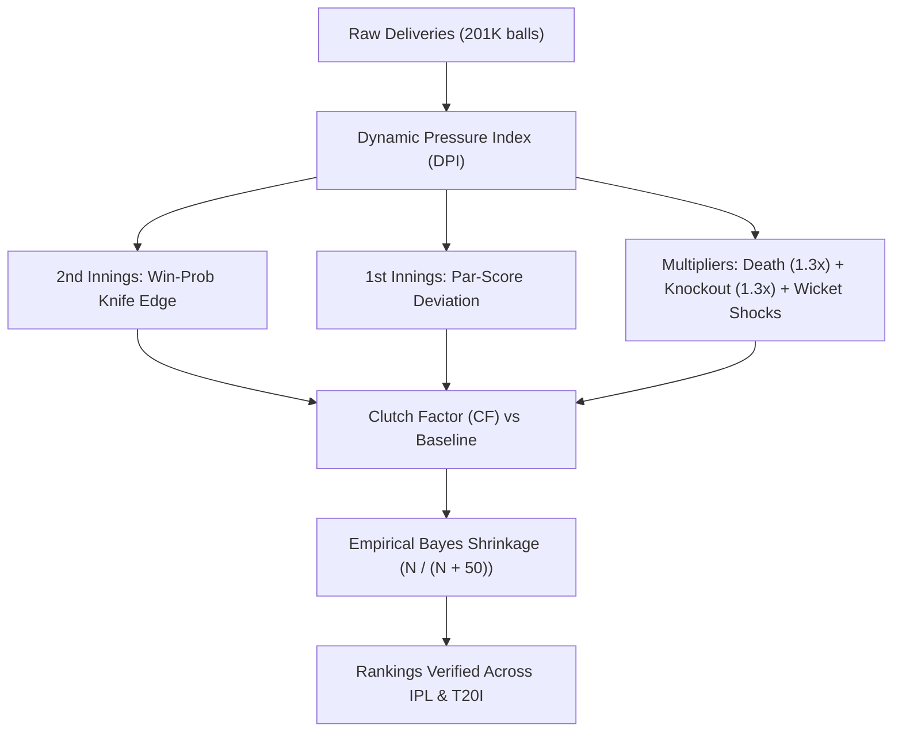

# 🏏 SupeRR Selector Season 2 — Rajasthan Royals Hackathon
### Identify the Most Reliable Players Under Pressure via Dynamic Win-Probability & Bayesian Clutch Modeling

[](https://share.streamlit.io)
[](https://www.python.org/)
[](https://opensource.org/licenses/MIT)

> **SupeRR Selector Season 2 (Round 1 Challenge)**  
> Built for the official Rajasthan Royals sports analytics challenge on Unstop.  
> Evaluated across **200,999 ball-by-ball deliveries** and **867 matches** (IPL & T20I, 2022–2026).

---

## 🚀 Live Interactive Dashboard
Deployable with one click on **Streamlit Community Cloud**:
- **Main App File:** `streamlit_app.py`
- **Dependencies:** `requirements.txt`
- **Standalone HTML Version:** `index.html` (or `dashboard/index.html`)

---

## 🏆 Official Top-10 Submission Lists (Unstop Dropdowns)

### 🏏 Top 10 Batters Under Pressure
| Rank | Player Name | Weighted Clutch | Raw Clutch | Pressure SR | Baseline SR | Pressure Avg | Baseline Avg | Pressure Balls |
|:---:|:---|:---:|:---:|:---:|:---:|:---:|:---:|:---:|
| **1** | **Mahedi Hasan** | **1.592** | 1.844 | 131.4 | 81.5 | 22.1 | 10.0 | 118 |
| **2** | **Washington Sundar** | **1.304** | 1.402 | 142.9 | 139.0 | 55.0 | 21.5 | 154 |
| **3** | **Rajat Patidar** | **1.216** | 1.272 | 149.0 | 172.9 | 96.3 | 30.5 | 194 |
| **4** | **Rahul Tewatia** | **1.203** | 1.290 | 152.1 | 148.4 | 44.5 | 21.5 | 117 |
| **5** | **Ayush Badoni** | **1.188** | 1.250 | 123.0 | 145.6 | 93.5 | 23.1 | 152 |
| **6** | **Abishek Porel** | **1.126** | 1.169 | 124.1 | 153.5 | 45.0 | 21.0 | 145 |
| **7** | **Vaibhav Sooryavanshi** | **1.124** | 1.146 | 227.5 | 221.4 | 57.1 | 36.7 | 276 |
| **8** | **Devdutt Padikkal** | **1.069** | 1.082 | 128.7 | 142.9 | 34.5 | 22.1 | 268 |
| **9** | **David Warner** | **1.067** | 1.076 | 132.0 | 151.9 | 62.4 | 36.1 | 378 |
| **10** | **Towhid Hridoy** | **1.042** | 1.051 | 108.9 | 131.1 | 49.0 | 28.0 | 225 |

---

### 🎳 Top 10 Bowlers Under Pressure
| Rank | Player Name | Weighted Clutch | Raw Clutch | Pressure Econ | Baseline Econ | Pressure Bowl SR | Baseline Bowl SR | Pressure Balls |
|:---:|:---|:---:|:---:|:---:|:---:|:---:|:---:|:---:|
| **1** | **Ripon Mondol** | **1.689** | 1.919 | 5.48 | 11.51 | 8.3 | 14.2 | 150 |
| **2** | **Wellington Masakadza** | **1.614** | 1.787 | 5.43 | 8.86 | 17.8 | 60.4 | 178 |
| **3** | **Salman Mirza** | **1.569** | 1.709 | 5.29 | 9.87 | 12.0 | 24.8 | 204 |
| **4** | **Arshad Khan** | **1.482** | 1.683 | 6.15 | 13.47 | 20.0 | 18.4 | 120 |
| **5** | **Jimmy Neesham** | **1.481** | 1.707 | 6.62 | 9.71 | 6.6 | 20.0 | 106 |
| **6** | **Dunith Wellalage** | **1.449** | 1.625 | 6.09 | 9.74 | 10.7 | 22.7 | 128 |
| **7** | **Daniel Sams** | **1.430** | 1.550 | 6.71 | 11.31 | 16.2 | 28.8 | 178 |
| **8** | **Patrick Cummins** | **1.411** | 1.472 | 6.80 | 10.40 | 15.3 | 21.5 | 336 |
| **9** | **Shaheen Afridi** | **1.373** | 1.416 | 5.99 | 10.01 | 12.8 | 16.4 | 434 |
| **10** | **Richard Ngarava** | **1.367** | 1.425 | 6.44 | 9.44 | 15.8 | 24.1 | 316 |

---

## 🔬 Core Methodology Overview



1. **Dynamic Pressure Index (DPI 0.0 to 1.0):**
   - **Second Innings:** Tension is highest when the match outcome is on a knife edge ($P(\text{Win}) \approx 50\%$): $\text{Balance} = 1.0 - 2.0 \times |P(\text{Win}) - 0.50|$.
   - **First Innings:** Deviation from expected par total given overs completed and wickets fallen.
   - **Leverage Multipliers:** Death overs (1.30×), Knockout/Playoff fixtures (1.30×), Momentum shock (+0.08 per recent wicket).
2. **Normalized Clutch Factor (CF):**
   - Batting evaluates Strike Rate, Average, Boundary %, and Non-Dot scoring efficiency.
   - Bowling evaluates Economy, Bowling Strike Rate, Dot Ball %, and Boundary suppression.
   - A player with baseline performance receives identically $1.000$; higher scores mean genuine elevation.
3. **Empirical Bayes Shrinkage:**
   - Small samples are shrunk toward the population mean: $\text{Weight} = \frac{N}{N + 50}$. Minimum threshold: $\ge 100$ pressure balls faced/bowled.

---

## 📂 Repository Structure

```
├── streamlit_app.py               # Main Streamlit Cloud App
├── requirements.txt               # Dependencies for Cloud deployment
├── index.html                     # Standalone HTML dashboard (zero server needed)
├── run_analysis.py                # Main analysis execution pipeline
├── Methodology_Report_SupeRR_Selector.pdf   # Official submission report (854 KB)
├── Methodology_Report_SupeRR_Selector.docx  # Word document report (766 KB)
├── Methodology_Report_SupeRR_Selector.md    # Markdown methodology
├── dashboard/
│   ├── app.py                     # Streamlit app mirror
│   ├── index.html                 # Interactive web dashboard
│   └── data/                      # Pre-calculated JSON metrics
│       ├── rankings.json
│       └── extras.json
├── src/
│   ├── data_loader.py             # Data loading and enrichment pipeline
│   ├── pressure_model.py          # DPI algorithm & win probability
│   ├── player_ranker.py           # Clutch Factor & Empirical Bayes ranker
│   └── visualizations.py          # Professional chart generator
└── output/                        # Generated PNG visual assets
```

---

## 🏃 Quick Start (Local Run)

```bash
# Clone the repository
git clone https://github.com/Harshgup16/SupeRR.git
cd SupeRR

# Install dependencies
pip install -r requirements.txt

# Run the Streamlit Dashboard
streamlit run streamlit_app.py

# Re-run full data science pipeline (optional)
python run_analysis.py
```

---
*Created for Rajasthan Royals SupeRR Selector Season 2 • Round 1*

